# Niky's Kitchen – case study

**Zdravé jídlo bez počítání a bez výčitek.** Web s recepty, webová appka a obchod, které spolu tvoří jeden celek. Osobní projekt a portfolio Niky (e-commerce, UX, web).

**🌐 Web:** https://4613nikola-oss.github.io/nikys-kitchen-web/ · **📱 Appka:** https://4613nikola-oss.github.io/jidlo-od-a-z/ · **🛍️ Shopify:** ukázkový obchod (vývojářský, zamčený heslem)

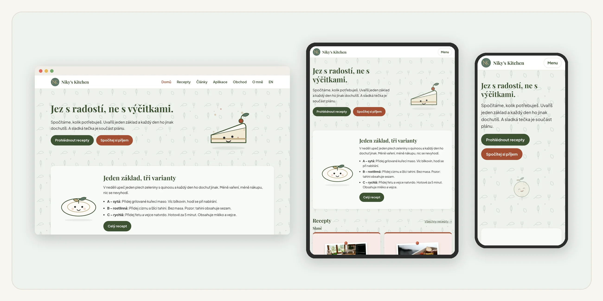

| | |
|---|---|
| **Moje role** | celý projekt: výzkum, persony, UX, design, texty, vývoj webu a appky, databáze, e-shop, automatizace |
| **Doba** | září – listopad 2026 (pokračuje) |
| **Nástroje** | Figma, Miro, Notion · Next.js, HTML/CSS/JS, PostgreSQL, Docker, GitHub Actions · Shopify, Make, Google Sheets · AI asistent Claude |
| **Repozitáře** | [`nikys-kitchen-web`](https://github.com/4613nikola-oss/nikys-kitchen-web) (nový web) · [`jidlo-od-a-z`](https://github.com/4613nikola-oss/jidlo-od-a-z) (appka) · [`nikys-kitchen`](https://github.com/4613nikola-oss/nikys-kitchen) (první web) · tento repozitář (podklady) |

**Obsah:** [Problém](#1-problém) · [Pro koho](#2-pro-koho) · [Řešení](#3-řešení-tři-části-jeden-cíl) · [Proces](#4-jak-jsem-postupovala) · [Web](#5-web) · [Appka](#6-appka-jídlo-od-az) · [Obchod a Shopify](#7-obchod-na-webu-a-shopify) · [Newsletter](#8-newsletter-bez-serveru) · [Technika](#9-technika-a-databáze) · [Design](#10-design-systém) · [Přístupnost a právo](#11-přístupnost-seo-a-soukromí) · [Výsledky](#12-výsledky-v-číslech) · [Co dál](#13-co-jsem-se-naučila-a-co-dál)

---

## 1. Problém

Hodně lidí chce jíst zdravě, ale v praxi narazí na tohle:

- **Neví, kolik toho sníst.** Kalkulačka dá číslo v kcal, ale neřekne, co si z toho dát k obědu.
- **Nemají čas.** Po práci nebo tréninku nechtějí složité recepty ani extra nákup.
- **Zapisování jídel je otravné.** Počítat každé sousto zabere čas a vede k výčitkám, proto s tím lidi brzy skončí.
- **Rady jsou roztroušené** po webech, appkách a sociálních sítích a často si odporují.

**Cíl:** jedna jasná odpověď na otázku *„co mám dnes jíst a kolik“*, bez zapisování a bez výčitek.

## 2. Pro koho

Ženy i muži 18+, kteří berou zdravé jídlo jako investici do budoucna, ale nemají moc času. Persony jsou hypotézy z průzkumu, které ještě ověřím rozhovory ([PERSONY.md](podklady/PERSONY.md), v Miru s fotkami).

| Persona | Věk | Cíl | Hlavní překážka | Co jí projekt dává |
|---|---|---|---|---|
| **Petra** ⭐ hlavní | 35 | zhubnout 5–10 kg | nemá čas, appky na počítání vzdala | Můj den, základ na víc dní, sladká tečka bez výčitek |
| **Tomáš** | 27 | nabrat svaly | krabičky jsou drahé | varianta „nabrat“, kurz vaření dopředu |
| **Jana** | 38 | jíst pravidelně na směny | celý den na nohou | rychlé recepty, nákupní seznam |
| **Kája** | 21 | jíst líp a levně | málo peněz i pozornosti | Lednička: vaří z toho, co má |
| **Martin** | 54 | zhubnout kvůli zdraví | neví jak, tlak, cukrovka | srozumitelné články, e-book pro starší |
| **Pavel** | 41 | vařit samostatně | weby nefungují se čtečkou | přístupnost (WCAG), čitelné texty |
| **Emma** | 31 | vařit z českých surovin | nemluví česky | angličtina |

## 3. Řešení: tři části, jeden cíl

| Část | Co dělá | Proč tam je |
|---|---|---|
| 🌐 **Web s blogem** | recepty, články, česky i anglicky | **přivádí lidi** z Googlu, Instagramu a Pinterestu |
| 📱 **Appka Jídlo od A–Z** | spočítá příjem, rozdělí ho do jídel, najde recepty podle ledničky, sestaví nákup | **pomůže v praxi**, zdarma |
| 🛒 **Obchod** | plány, e-booky, kurzy (na webu) + ukázkový Shopify s krabičkami a merchem | **pro ty, kdo chtějí víc** – a portfolio e-commerce |

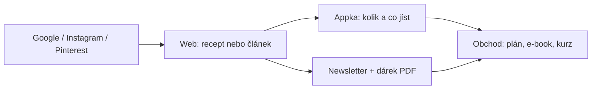

**Čím je to jiné:** žádné zapisování jídel · jeden základ a tři varianty (zhubnout / udržet / nabrat), takže se vaří jednou pro celou rodinu · vaří se z toho, co je doma · sladká tečka patří do plánu · krátké texty „v kostce“ · ověřené zdroje, žádné zdravotní sliby.

## 4. Jak jsem postupovala

1. **Výzkum a brainstorming** – konkurence, věda se zdroji, koncepty, kalkulačka ([BRAINSTORMING.md](podklady/BRAINSTORMING.md)).
2. **Persony, mapa webu a cesta uživatele** – [PERSONY.md](podklady/PERSONY.md), [SITEMAP.md](podklady/SITEMAP.md), [FLOW.md](podklady/FLOW.md), tabule v Miru.
3. **První verze** – web v čistém HTML/CSS a appka Jídlo od A–Z (online od září 2026).
4. **Nový web v Next.js** – dva jazyky, statický export, nasazení přes GitHub Actions.
5. **Jedna databáze** – recepty a články uložené jen jednou, web i appka čtou stejná data.
6. **Kritika a opravy (fáze A)** – filtry, hledání s překlepy, kontrast, klikací karty, alergeny.
7. **Obchod, newsletter, právo** – produkty a ceny podle průzkumu trhu, „Mám zájem“ místo předčasného „Koupit“, ochrana soukromí, přístupnost, SEO.
8. **Nový vzhled (fáze B)** – Tečka v tenké lince jako logo, vlastní ikonky, bylinkové pozadí, karta jako polaroid, mikroanimace.
9. **Shopify** – ukázkový obchod se třemi druhy zboží, kolekcemi, skladem, slevou a testovací objednávkou.

Rozhodnutí a jejich důvody jsou zapsané v [PROJEKT.md](PROJEKT.md).

## 5. Web

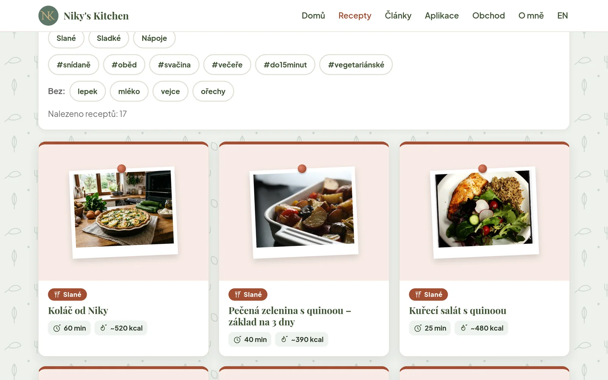

- **17 receptů** (slané, sladké, nápoje), každý s fotkou, časem, kcal a alergeny.
- **Hledání, které zvládne překlepy** („omleta“ najde omeletu) a nabídne podobné recepty.
- **Filtry** podle kategorie, jídla (#snídaně, #do15minut, #vegetariánské) a „bez alergenu“.
- **Recept na 1 porci** s přepočtem surovin i kcal, **odškrtávání surovin** při vaření, **tisk do PDF**.
- **Jeden základ, tři varianty** – varianty po dnech, aby se vařilo jednou na víc dní.
- **6 článků** – nejdřív „v kostce“, víc po rozkliknutí, se zdroji.

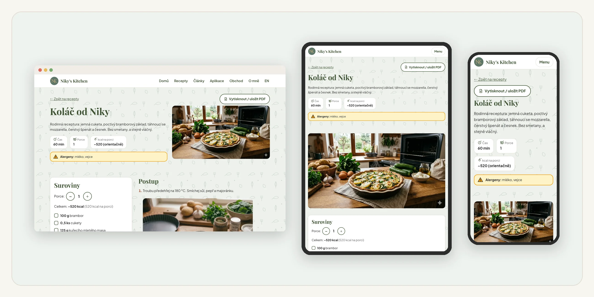

## 6. Appka Jídlo od A–Z

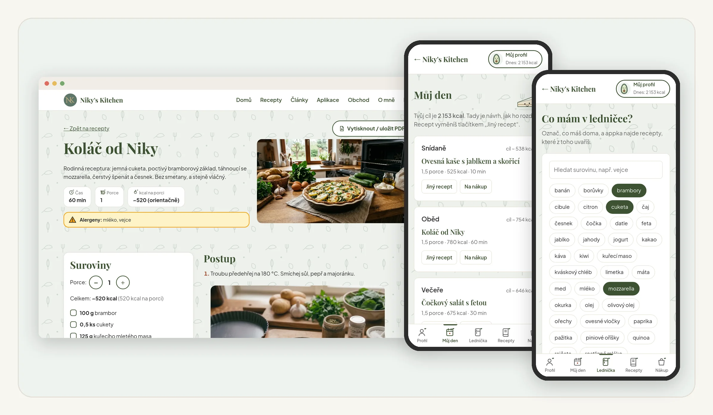

| Profil s avatarem | Můj den |
|---|---|
| 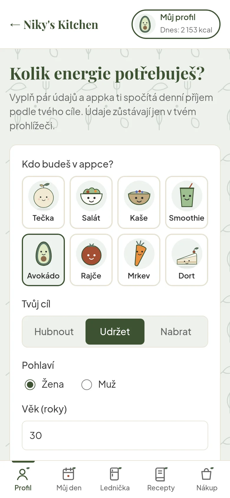 | 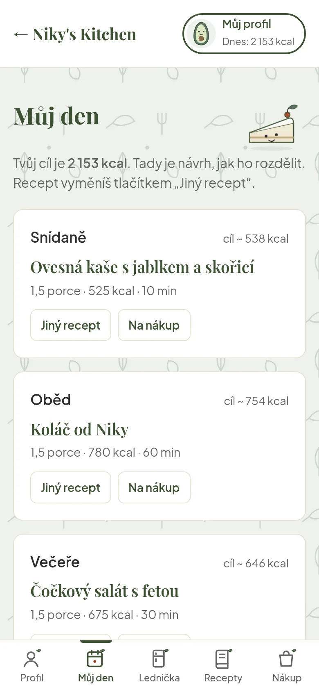 |

- **Profil** – výpočet příjmu podle Mifflin-St Jeor, jen pro dospělé, nikdy pod bazální metabolismus. Výběr avatara (Tečka, salát, avokádo…).
- **Můj den** – příjem rozdělený do snídaně, oběda, svačiny a večeře, recepty a porce na míru.
- **Lednička** – recepty z toho, co je doma. **Nákup** – seznam z receptů nebo celého dne.
- Údaje zůstávají jen v prohlížeči (localStorage). Appka jde přidat na plochu mobilu (PWA).

## 7. Obchod na webu a Shopify

**Na webu:** 7 produktů z databáze (Týdenní plán 99 Kč, dva e-booky, Online kuchařka, kurz online a kurz naživo, Startovací knížka zdarma). Ceny vycházejí z průzkumu trhu a z „žebříčku“: zdarma přivede → malá placená věc → větší nabídka. Produkty zatím nejsou dopsané, proto je u nich poctivě **„Mám zájem“** místo „Koupit“.

| Obchod | Kurz vaření naživo |
|---|---|
| 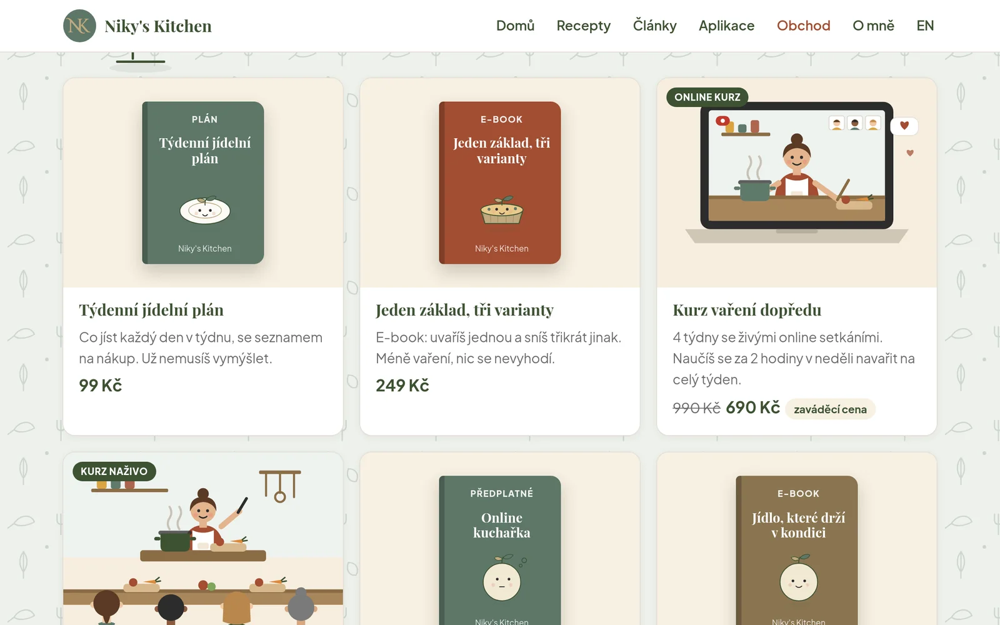 | 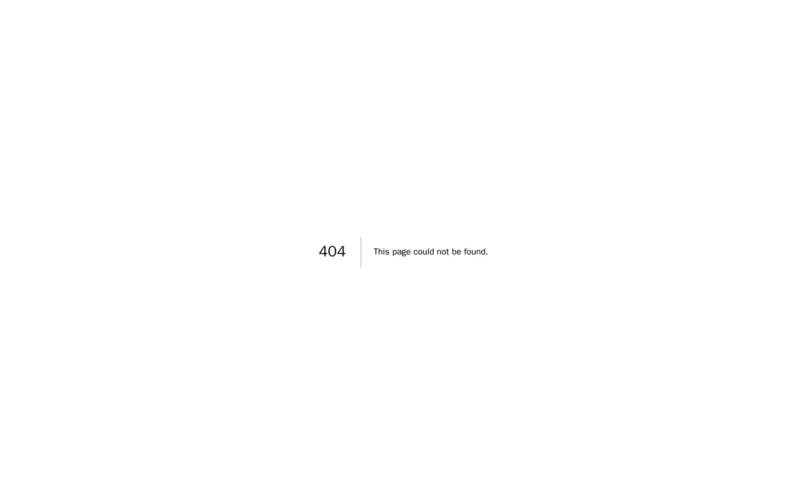 |

**Shopify (ukázkový obchod do portfolia):** tři druhy zboží, každý s jiným nastavením.

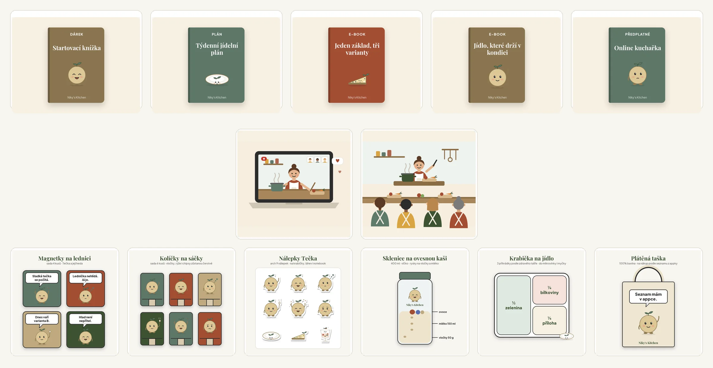

| Co | Jak je to nastavené |
|---|---|
| **Krabičky s obědy** | varianty Fit / Standard / Svaly, SKU, sledování skladu, ruční kolekce |
| **Digitální produkty a kurzy** | bez dopravy (`requiresShipping: false`), chytré kolekce podle typu produktu |
| **Merch s Tečkou** | magnetky, kolíčky, nálepky, sklenice, krabička, taška – vlastní návrhy |
| **Marketing** | slevový kód VITEJ10 (10 %, jednou na zákazníka) za přihlášení k newsletteru |
| **Proces** | testovací objednávka od konceptu po vyřízení |

Část úprav jsem dělala přes **Shopify Admin API (GraphQL)**, část v administraci. Postup je popsaný v lekci v Notionu a v mé E-commerce akademii.

## 8. Newsletter bez serveru

Web je statický, takže neumí ukládat data. Přihlášky proto jdou přes automatizaci:

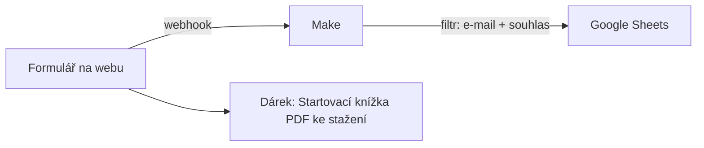

Zdarma (Make 1 000 operací měsíčně), se souhlasem podle GDPR a s pastí na roboty. Dárek je **Startovací knížka**: 12 stran A5, 7 receptů do 15 minut, talíř, nákupní seznam a tipy, vygenerovaná přímo z databáze receptů.

## 9. Technika a databáze

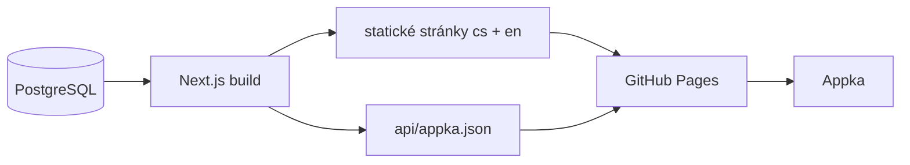

| Vrstva | Technologie | Proč |
|---|---|---|
| Web | Next.js 16 (App Router), statický export | rychlý, bezpečný, hosting zdarma |
| Data | PostgreSQL 17, 14 tabulek, pohled pro appku | recepty jen jednou, pravidla přímo v databázi |
| Vývoj | Docker Compose (web, databáze, Adminer) | nic se neinstaluje do počítače |
| Nasazení | GitHub Actions s dočasnou databází → GitHub Pages | po nahrání na `main` se web sám sestaví |
| Appka | čisté HTML/CSS/JS, PWA | jednoduché, funguje všude, i offline se zálohou |

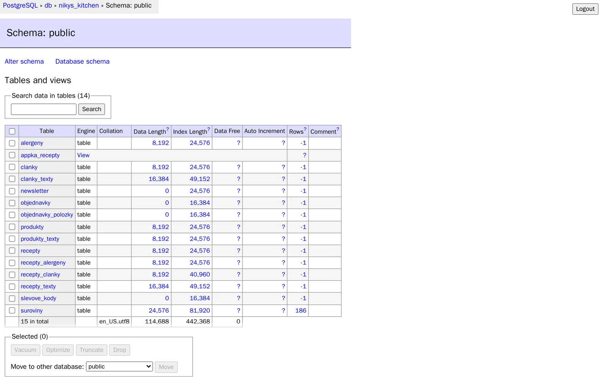

## 10. Design systém

| Barva | Kód | Použití |
|---|---|---|
| Tmavá šalvěj | `#3d5233` | nadpisy, tlačítka (kontrast 7,9 : 1) |
| Šalvěj | `#5e7769` | logo, plochy, nápoje |
| Med | `#bfa97f` | ozdoby, sladké |
| Terakota | `#a24e33` | hlavní výzva, slané |
| Bylinkové pozadí | `#edf1ec` + jemný vzor | celý web a appka |

**Písma:** Playfair Display (nadpisy) a Plus Jakarta Sans (text). **Maskot Tečka:** tenká linka jako logo, mění se v jídlo (talíř, pohár, dort…). **Vlastní ikonky** (29) místo emoji, se stejným lístkem jako Tečka.

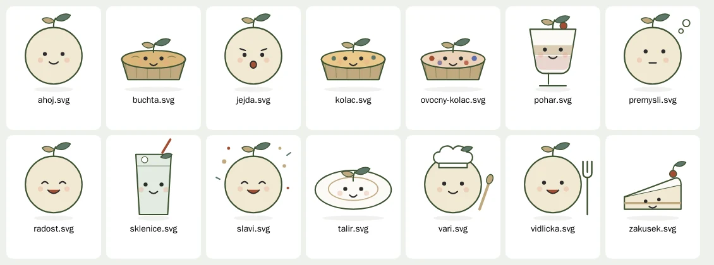

**Mikroanimace** hrají jen chvilku a respektují nastavení „omezit pohyb“:

| Tečka se promění v dort | Odškrtnutí na nákupu |
|---|---|
| 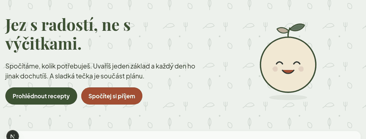 | 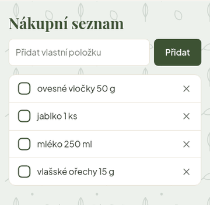 |

## 11. Přístupnost, SEO a soukromí

- **Přístupnost (WCAG AA):** kontrast textu, ovládání klávesnicí, viditelný fokus, popisky pro čtečky, alergeny barvou i ikonou, animace vypnutelné. Prohlášení o přístupnosti na webu.
- **SEO:** mapa webu, propojení cs/en (hreflang), náhledy při sdílení, data receptů pro Google (schema.org/Recipe).
- **Soukromí:** stránka Ochrana soukromí, appka ukládá jen do prohlížeče, newsletter jen se souhlasem. Fotky receptů s volnou licencí a uvedeným autorem.
- **Bezpečnost:** žádná hesla v repozitářích (`.gitignore`, `.env`), rizika v `security_warnings.md`, aktualizace kritické zranitelnosti Next.js.

## 12. Výsledky v číslech

| | |
|---|---|
| 17 receptů · 6 článků · 2 jazyky | 84 statických stránek |
| 14 tabulek v databázi | 1 zdroj dat pro web i appku |
| 7 produktů na webu, 14 v Shopify | 4 kolekce, 1 slevový kód, 1 objednávka |
| 29 ikonek, 14 podob Tečky | 2 mikroanimace |
| 0 Kč měsíčně | vše na bezplatných službách |

## 13. Co jsem se naučila a co dál

**Naučila jsem se:** navrhnout databázi a napojit na ni web i appku · nasazovat přes GitHub Actions · přemýšlet o přístupnosti od začátku · stavět e-shop v Shopify včetně skladu a slev · automatizovat bez serveru (Make) · psát pravdivě: radši „Mám zájem“ než prodávat něco, co ještě není.

**Co dál:**
- dopsat produkty (týdenní plán, e-booky) a vlastní fotky jídel místo ilustračních,
- ověřit persony rozhovory a dotazníkem,
- appka přímo na webu (fáze C), přihlášení (D), komunita a recepty od babičky (E),
- obálky a merch v Shopify překreslit do nové podoby Tečky,
- skutečný prodej až s živnostenským listem a platební bránou.

---

## Co je v tomhle repozitáři

```
PROJEKT.md             kniha projektu – rozhodnutí, úkoly, nápady (začni tady)
CLAUDE.md              pravidla pro AI asistenta
docs/case-study/       obrázky a animace k této case study
podklady/
  DASHBOARD.md         rozcestník a stav projektu
  BRAINSTORMING.md     průzkum, konkurence, věda se zdroji, koncepty
  SITEMAP.md           mapa webu
  PERSONY.md           pro koho to děláme
  FLOW.md              cesta uživatele web → appka → obchod
  SOCIALNI-SITE.md     Instagram, Facebook, plán příspěvků
  navrhy/              návrhy vzhledu (pozadí, Tečka, ikonky, animace)
  logo/                logo NK ve vektoru
  maskot/              maskot Tečka – nálady a proměny
```

Repozitář je veřejný. Hesla a soukromé soubory sem nepatří (složka `soukrome/` se nenahrává).
